# SOUL · Document Templates — design

Design files for the SOUL module **Document Templates** admin tool (Radius Agent): upload templates, tag fields with Mel, mark templates default per transaction type, and the PDF editor feedback batches.

Exported from the Claude Design canvas **SOUL — Document Templates** on 2026-11-16.

## Folders

| Path | What |
|---|---|
| `screenshots/<page>/` | PNG of every artboard at 2x, grouped by canvas page, numbered in canvas order |
| `design/canvas.json` | Canvas index: pages, artboard frames, section titles and sticky notes |
| `design/*.dc.html` | Artboard source (Claude Design component format). Renders inside Claude Design, not as plain HTML |
| `design/ds/radius-ui/` | Radius UI design system tokens, components CSS and bundle used by the artboards |
| `design/src/regular/` | Phosphor icon font |
| `design/assets/` | Logo and Mel icon |

Note: the Claude Design runtime (`support.js`) is not included. The step artboards (`B1-*`, `B2-*`, `Defaults-*`) are thin wrappers that render `Main.dc.html` or `B2-Editor.dc.html` in a preset state.

## Pages and artboards

### Admin portal prototype

#### Document Templates v2

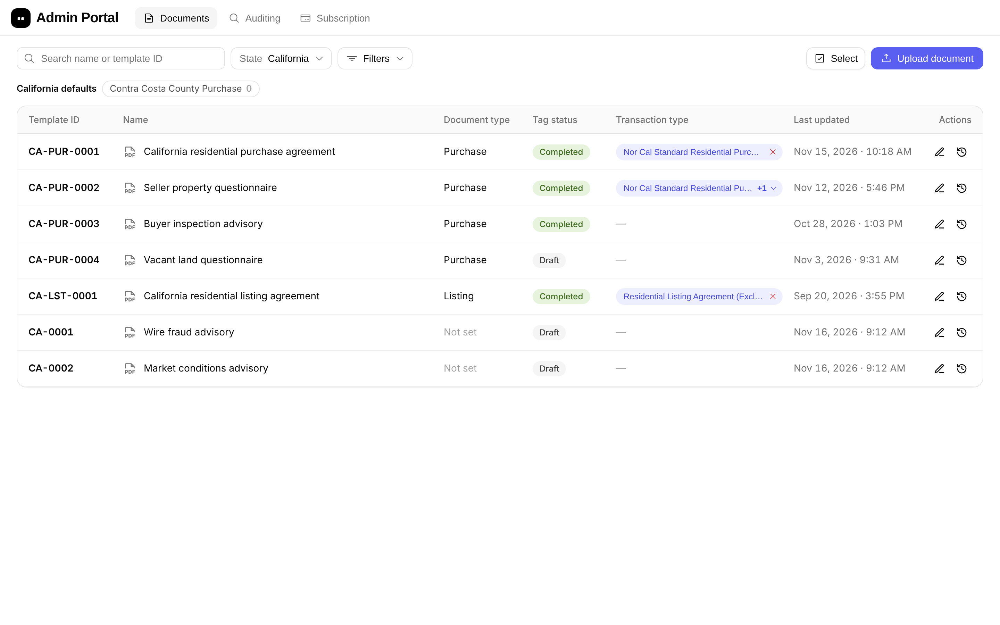

Source: `design/Main.dc.html` · 1440×900

### App

#### PDF Filler Mobile copy

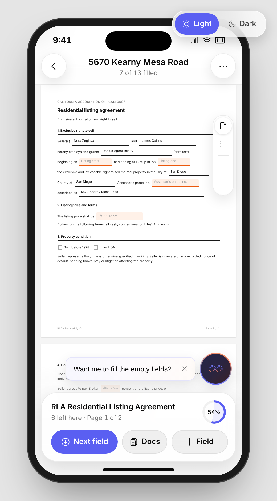

Source: `design/PDF-Filler-Mobile-omt9.dc.html` · 520×940

#### PDF Filler Mobile Screen copy

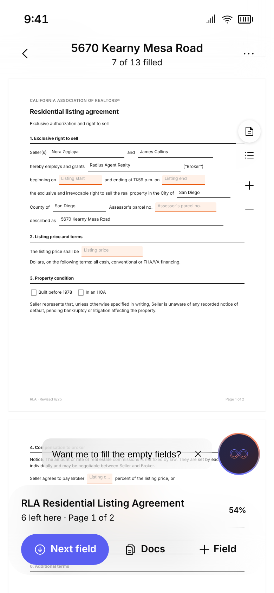

Source: `design/PDF-Filler-Mobile-Screen-b963.dc.html` · 390×844

#### PDF Filler (web)

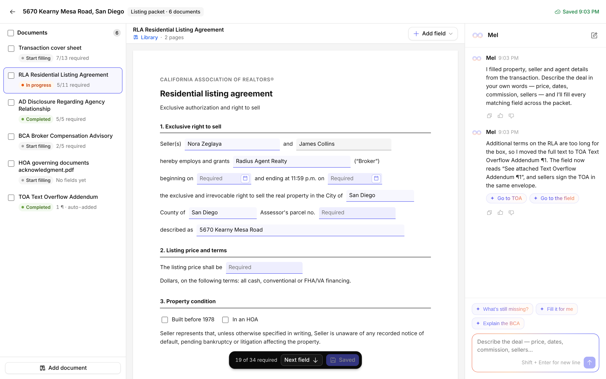

Source: `design/PDF-Filler.dc.html` · 1440×900

### Mark it default

#### Document Templates v2 copy

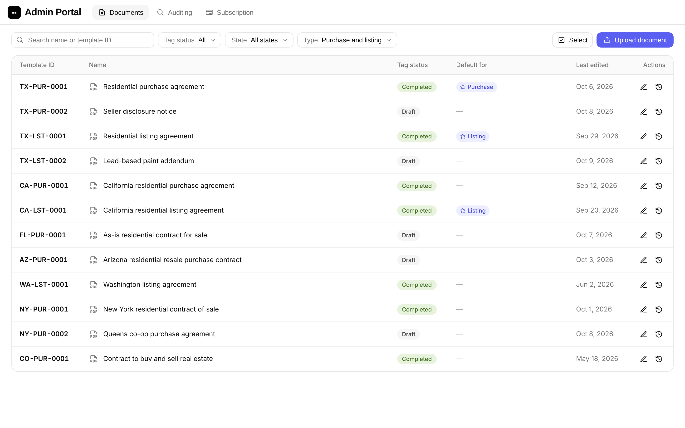

Source: `design/Main-rke2-7etz.dc.html` · 1440×900

#### 1 · Select mode copy

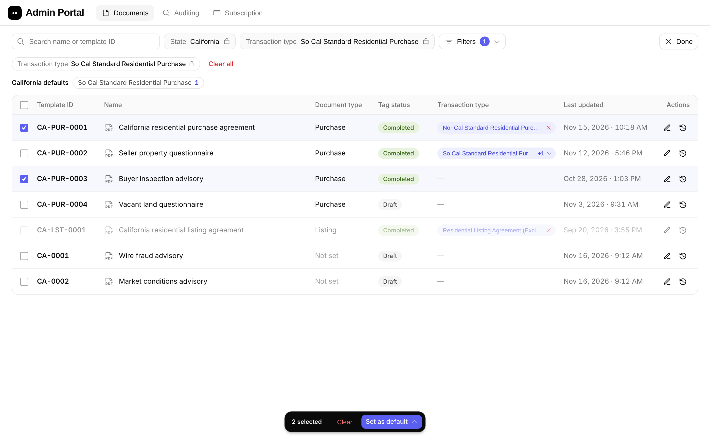

Source: `design/Defaults-1-Select-cilv.dc.html` · 1440×900

#### 2 · Search while selecting copy

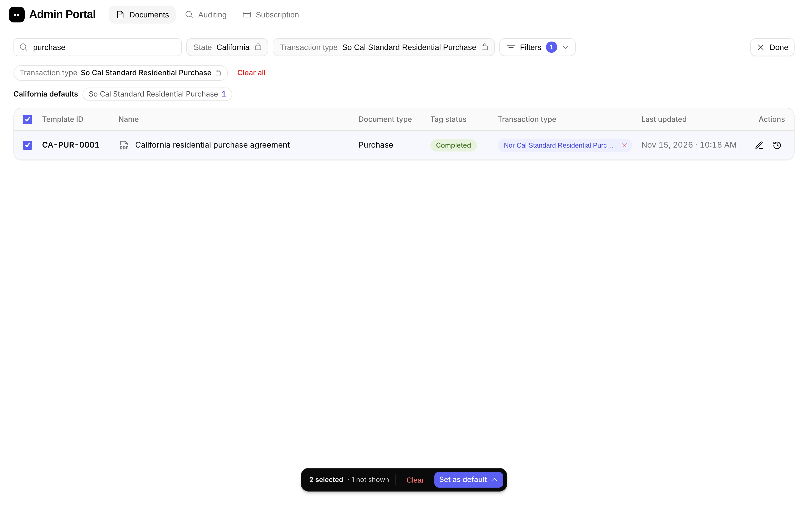

Source: `design/Defaults-2-Search-52yw.dc.html` · 1440×900

#### 3 · Set as default menu copy

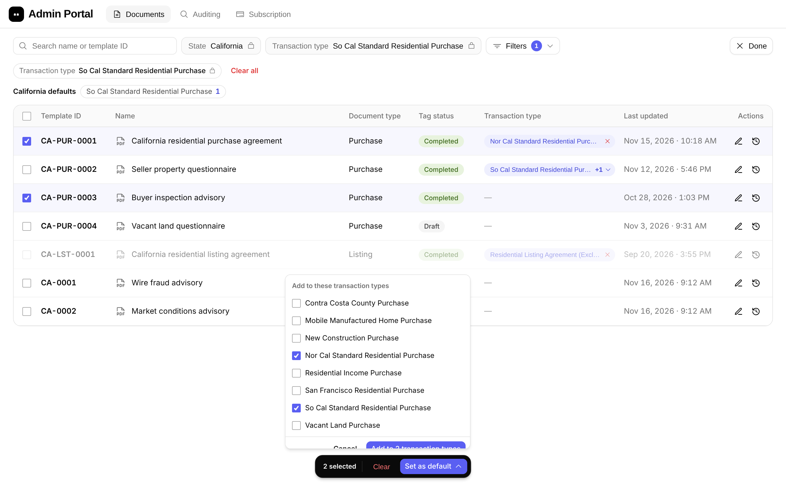

Source: `design/Defaults-3-Menu-mp21.dc.html` · 1440×900

#### 4 · Drafts get skipped copy

Source: `design/Defaults-4-Drafts-8ny9.dc.html` · 1440×900

#### 5 · Confirmation + undo copy

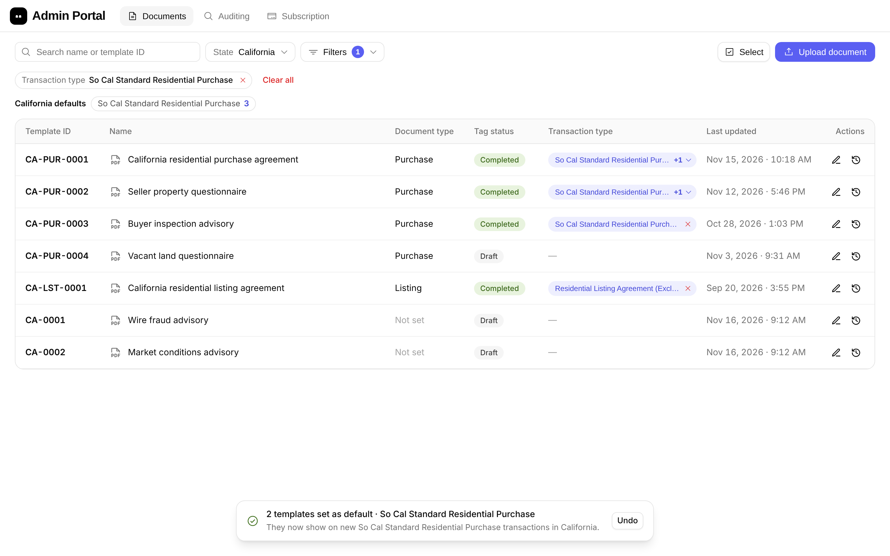

Source: `design/Defaults-5-Toast-bpcx.dc.html` · 1440×900

#### 6 · Default for column copy

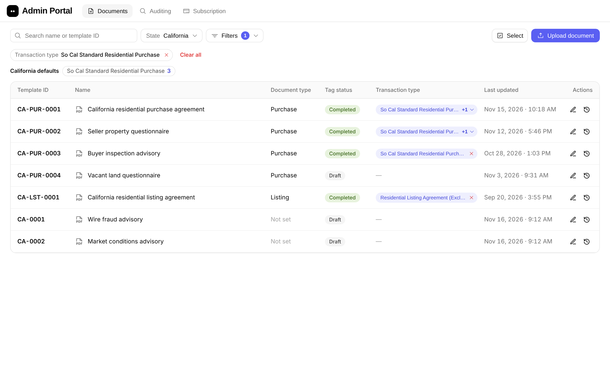

Source: `design/Defaults-6-Badges-t1lm.dc.html` · 1440×900

### PDF editor feedback · Batch 1

#### 1 · Upload: details first

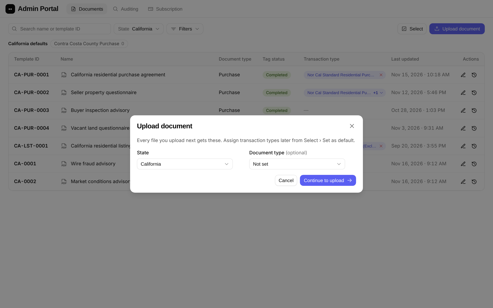

Source: `design/B1-1-Upload-Details.dc.html` · 1440×900

> 1 · Upload: details first  
> What: upload opens with State, Area (NY only) and Document type (optional). Transaction type is removed.  
> Why: Jessica #1. Build the library first, assign transaction types later.  
> Rule: Continue is always on. No document type → ID has no side (CA-0001).

#### 2 · Upload: drop files

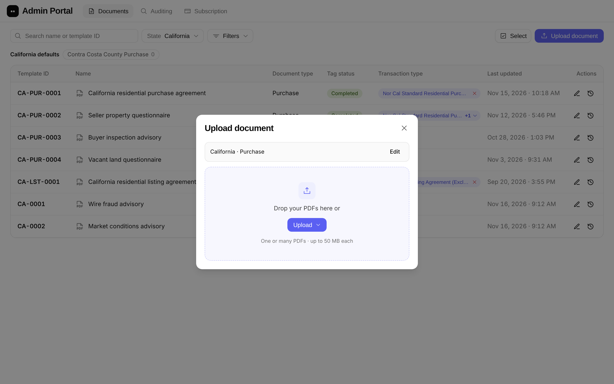

Source: `design/B1-2-Upload-Drop.dc.html` · 1440×900

> 2 · Upload: drop files  
> What: summary bar shows State · Document type with Edit. Every file dropped next inherits these.  
> Rule: batch upload goes straight to the editor.

#### 3 · Assign later: Set as default

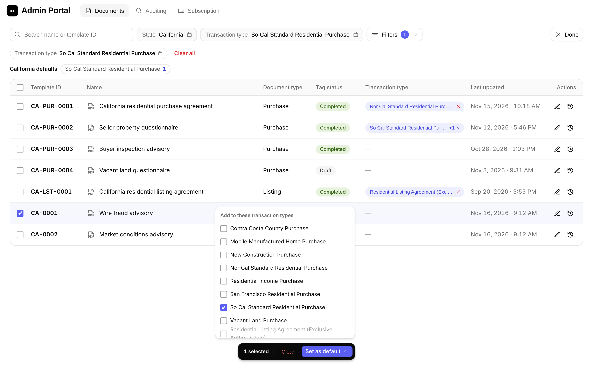

Source: `design/B1-3-Assign-Menu.dc.html` · 1440×900

> 3 · Assign later: Set as default  
> What: Select mode → tick a template with no document type (CA-0001) → Set as default.  
> Rule: the menu lists Purchase and Listing types. The first tick greys out the other side. Templates with no type can join either side.

#### 4 · Assign later: confirmed

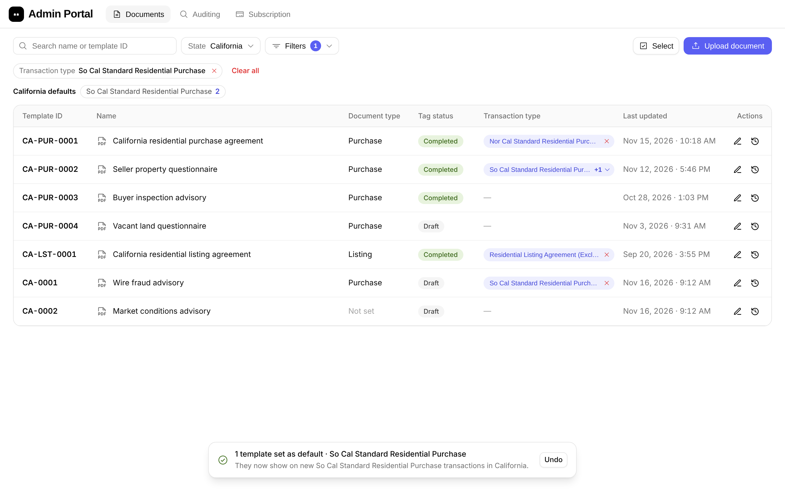

Source: `design/B1-4-Assign-Done.dc.html` · 1440×900

> 4 · Assign later: confirmed  
> What: toast with Undo. The row's Document type fills in from the transaction type picked (Purchase).  
> Rule: Undo reverts both the default and the document type.

#### 5 · Mel autofills tag

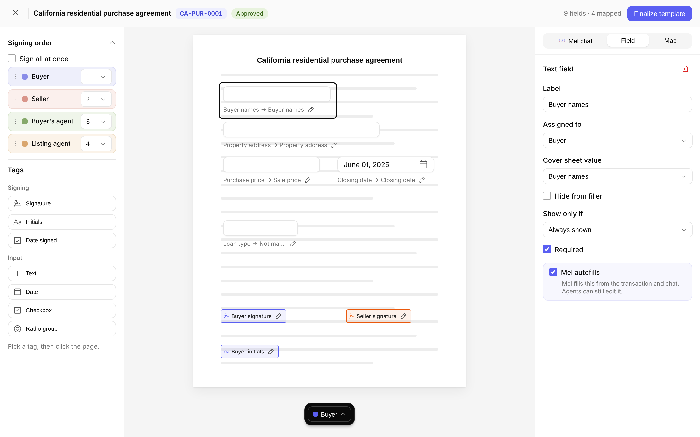

Source: `design/B1-5-Mel-Autofill.dc.html` · 1440×900

> 5 · Mel autofills  
> What: per-tag checkbox in the tag properties panel. Ticked tags show an indigo sparkle on the PDF.  
> Why: Ashuthosh. Mel chat and autofill need this flag from SOUL.  
> Rule: agents can still edit a value Mel filled.

#### 6 · Table: new columns

Source: `design/B1-6-Table-Columns.dc.html` · 1440×900

> 6 · Table: new columns  
> What: new Document type column (Purchase, Listing, Not set). Last edited → Last updated, with date and time.  
> Why: Jessica #11.

#### 7 · Filters popover

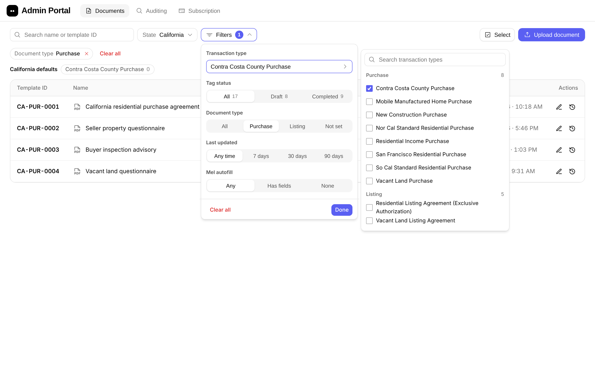

Source: `design/B1-7-Filters-Open.dc.html` · 1440×900

> 7 · Filters popover  
> What: bar keeps Search, State, Area. The rest moves into Filters: Transaction type (list opens to the right), Tag status, Document type, Last updated, Mel autofill.  
> Why: Jessica #12.  
> Rule: filters apply live. Badge counts active filters. Done closes.

#### 8 · Active filter chips

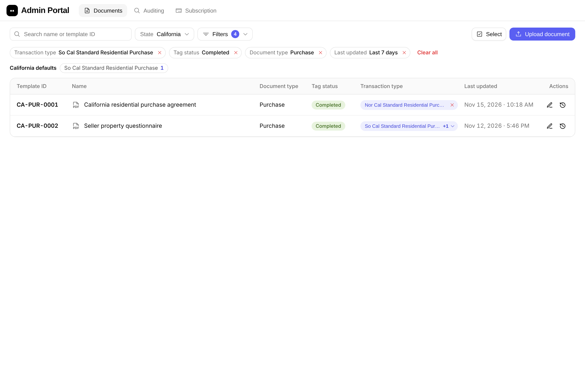

Source: `design/B1-8-Filter-Chips.dc.html` · 1440×900

> 8 · Active filter chips  
> What: each active filter shows as a chip under the bar, with a red ×. Clear all resets.  
> Rule: in Select mode the Transaction type chip is locked.

### PDF editor feedback · Batch 2

#### 0 · Tag editor · all new parts

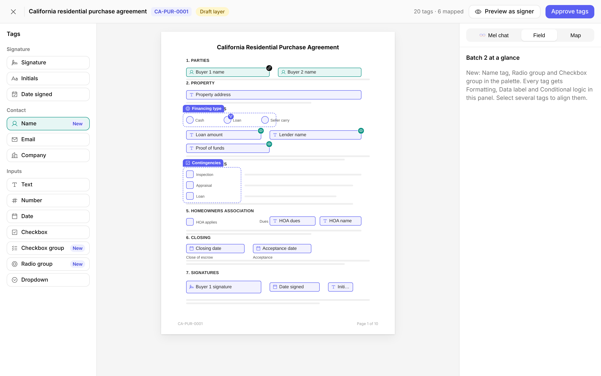

Source: `design/B2-Editor.dc.html` · 1440×900

> Shared component behind every Batch 2 artboard.  
> What: new tags (Name, Radio group, Checkbox group) in the palette. Every tag gets Formatting, Data label and Conditional logic in the Field tab.  
> Badges on tags: link = shares a data label, branch = triggers a rule, eye = shown by a rule.

#### 1 · Name tag · place and set up

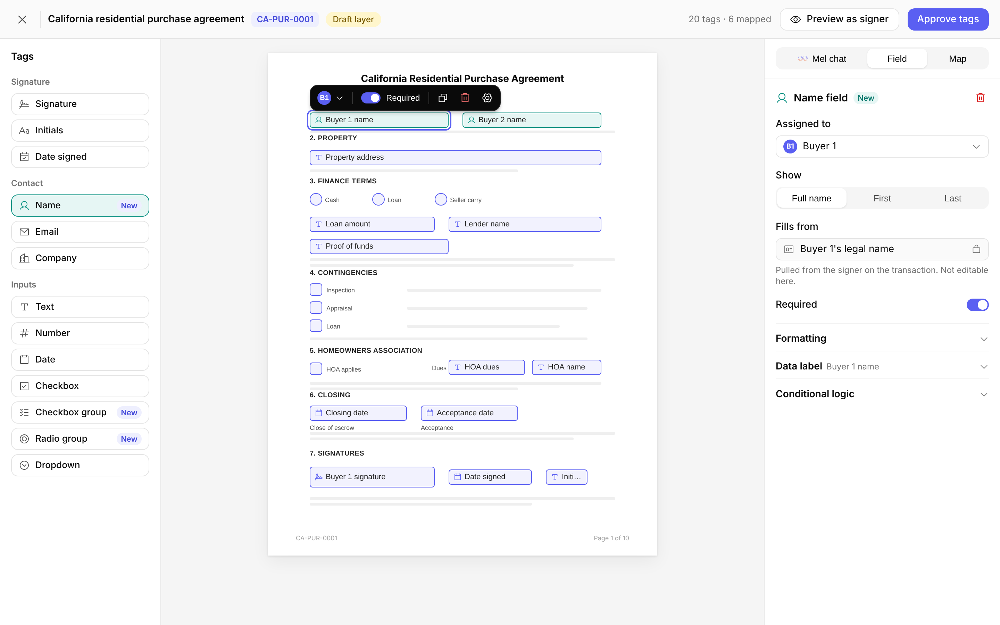

Source: `design/B2-N1-Name-Place.dc.html` · 1440×900

> Use case: TC drops a Name tag for Buyer 1.  
> What: teal fill and user icon so it never reads as a plain Text tag. Show Full / First / Last. Fills from the signer on the transaction and can't be typed over in the template.  
> Rule: the signer badge colour still shows who it belongs to.

#### 2 · Name tag · signer not on every deal

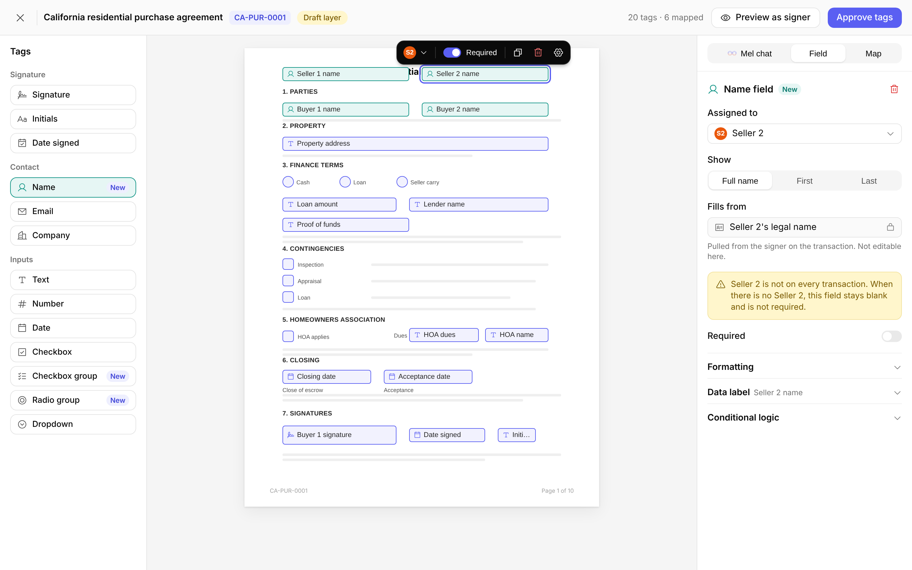

Source: `design/B2-N2-Name-Missing.dc.html` · 1440×900

> Edge: Seller 2 is optional on many deals.  
> What: warning in the panel. Required turns off and locks for optional signers.  
> Rule: no Seller 2 on the deal → field prints blank, never blocks signing.

#### 3 · Formatting · one tag

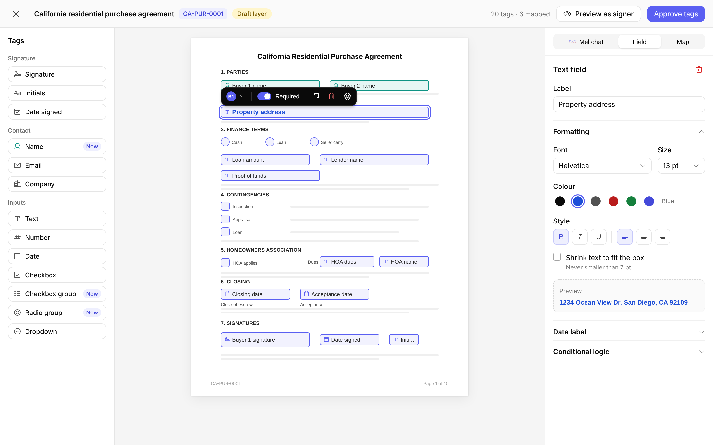

Source: `design/B2-T1-Format-Single.dc.html` · 1440×900

> Use case: make the property address bold and blue.  
> What: Formatting section has font, size, colour swatches, B / I / U and text alignment, with a live preview. The tag on the PDF updates as you change it.  
> Rule: applies to text, name, date, number and dropdown tags.

#### 4 · Formatting · several tags

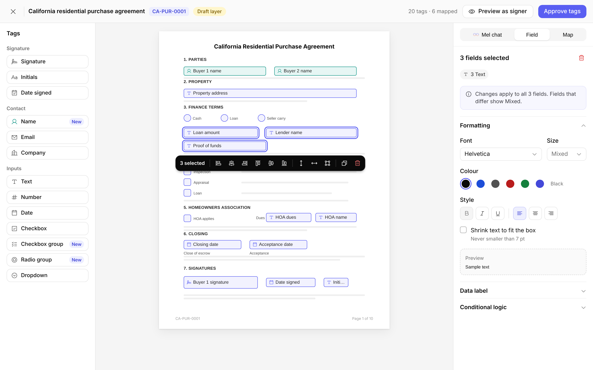

Source: `design/B2-T2-Format-Multi.dc.html` · 1440×900

> Use case: set 3 finance fields to the same style in one go.  
> What: select several tags → Formatting edits all. Values that differ show Mixed. Bold shows as half-on.  
> Rule: picking a value overwrites Mixed for all selected.

#### 5 · Formatting · text too big

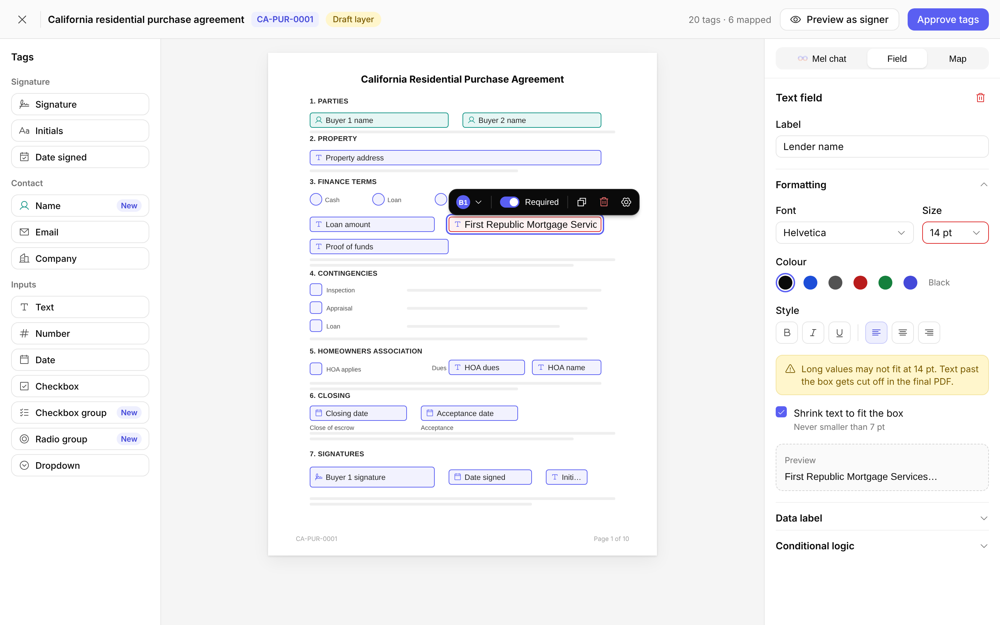

Source: `design/B2-T3-Format-Overflow.dc.html` · 1440×900

> Edge: 14 pt and a long lender name don't fit the box.  
> What: red tag on the page, warning in the panel, Size field red.  
> Rule: 'Shrink text to fit' on by default, 7 pt floor. Below that the text is cut off and the warning stays.

#### 6 · Radio group · create

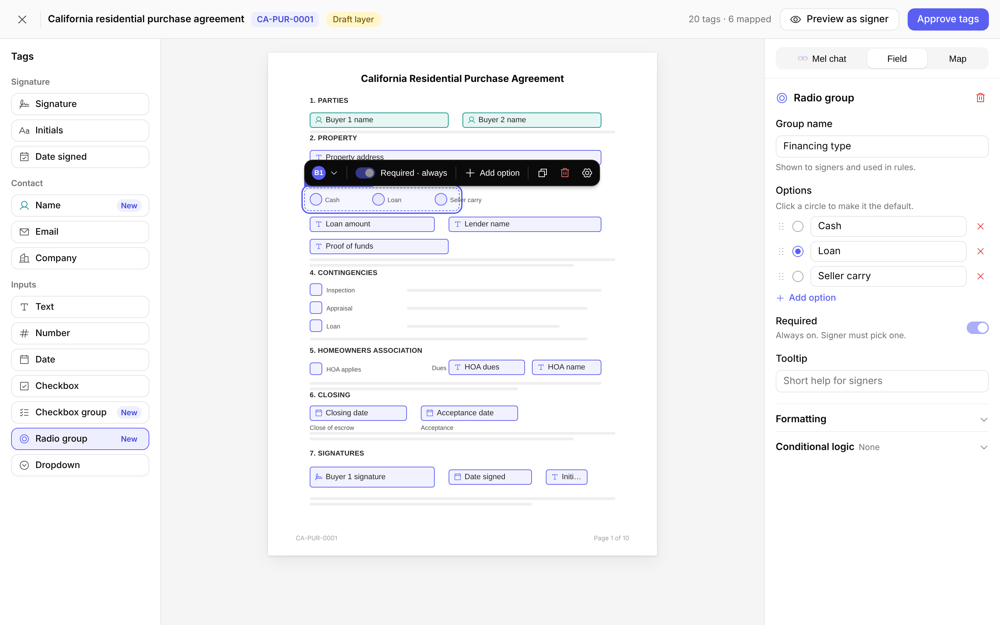

Source: `design/B2-R1-Radio-Create.dc.html` · 1440×900

> Use case: Financing type with Cash / Loan / Seller carry.  
> What: dashed group frame with name tab on the page. Option list with drag to reorder. Click a circle to set a default.  
> Rule: Required is always on and locked. Signer must pick exactly one.

#### 7 · Radio group · errors

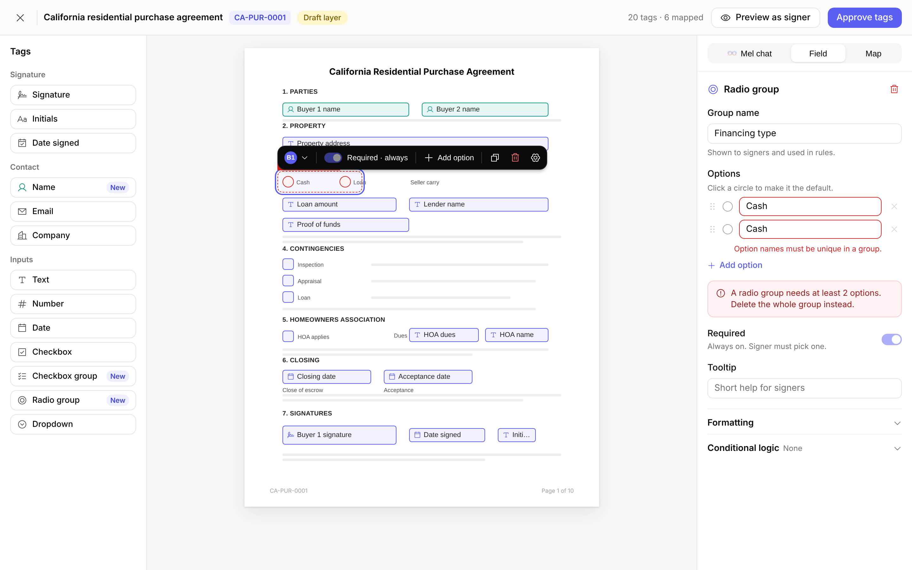

Source: `design/B2-R2-Radio-Errors.dc.html` · 1440×900

> Edges: (a) deleting down to 1 option is blocked, so the × greys out at 2. (b) Two options both named Cash shows an inline error, and the tags turn red.  
> Rule: you can't approve tags until these are fixed.

#### 8 · Radio group · add option on page

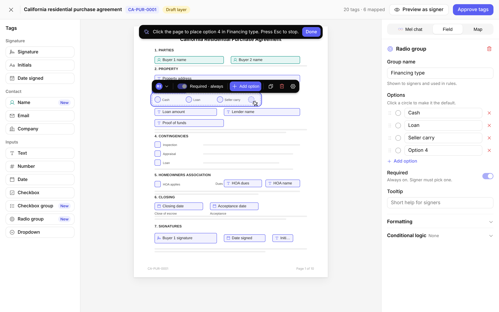

Source: `design/B2-R3-Radio-Add-Option.dc.html` · 1440×900

> Use case: the form has a 4th box to tag.  
> What: '+ Add option' in the mini toolbar → click to place, repeats until Esc or Done. The group frame grows to fit.  
> Rule: options must stay on the same page as their group.

#### 9 · Checkbox group · create

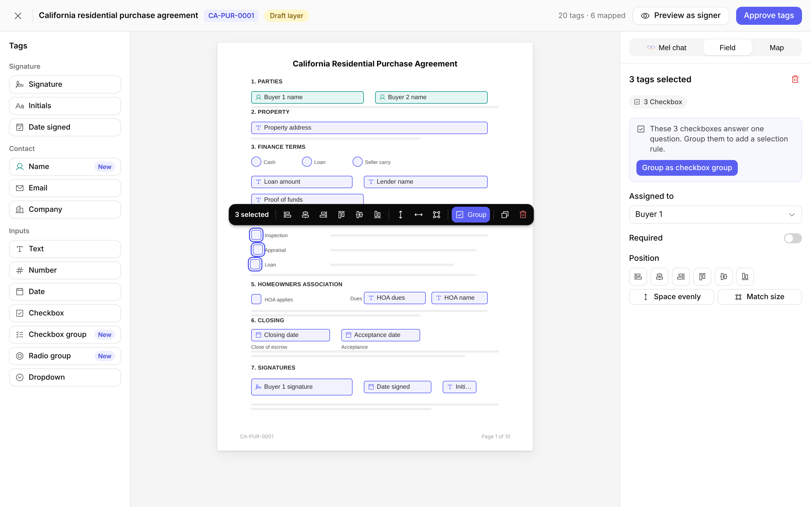

Source: `design/B2-C1-Checkbox-Select-Group.dc.html` · 1440×900

> Use case: Inspection, Appraisal, Loan answer one question.  
> What: select the boxes → 'Group' in the selection bar, or the CTA in the panel.  
> Rule: only checkboxes can be grouped. A box can be in one group.

#### 10 · Checkbox group · selection rule

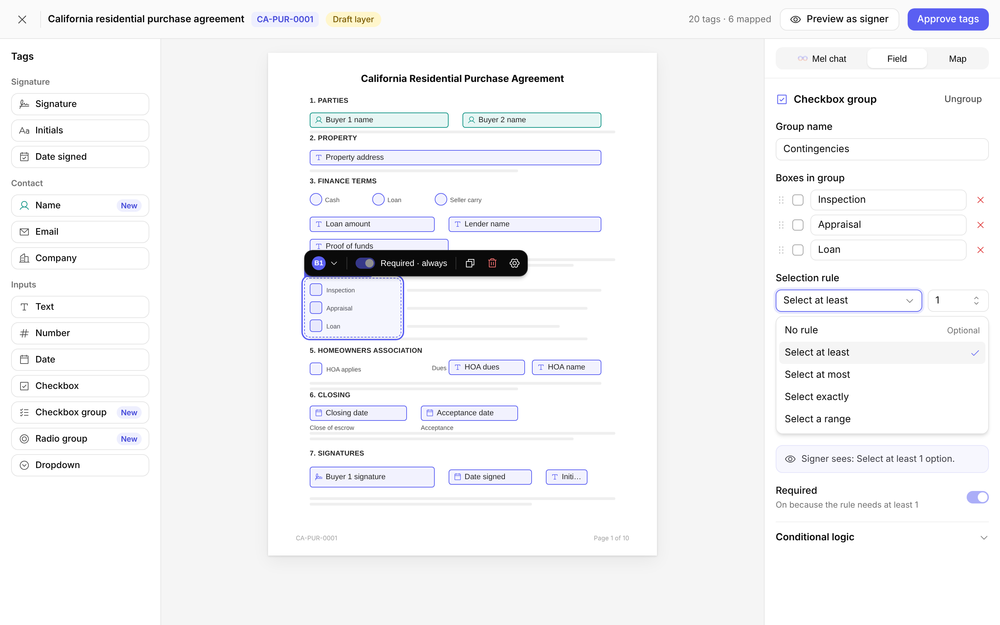

Source: `design/B2-C2-Checkbox-Rule.dc.html` · 1440×900

> What: Selection rule options are No rule (optional), Select at least, Select at most, Select exactly, or Select a range. A preview shows what the signer sees.  
> Rule: Required follows the rule. On if the minimum is 1 or more, off for No rule or 'at most'.

#### 11 · Checkbox group · one box selected

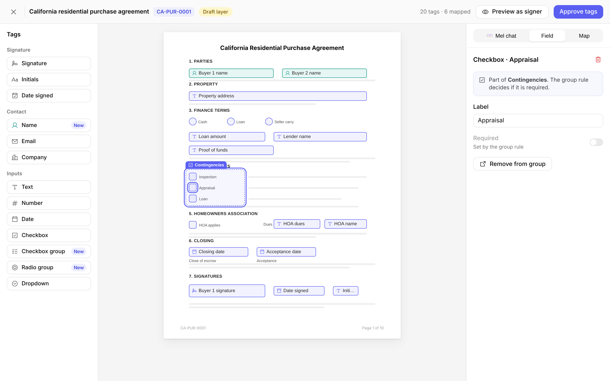

Source: `design/B2-C3-Checkbox-In-Group.dc.html` · 1440×900

> Edge: TC tries to make one box in a group required.  
> What: Required is locked with 'Set by the group rule'. 'Remove from group' frees the box.  
> Rule: grouped boxes can't have their own required setting.

#### 12 · Checkbox group · impossible rule

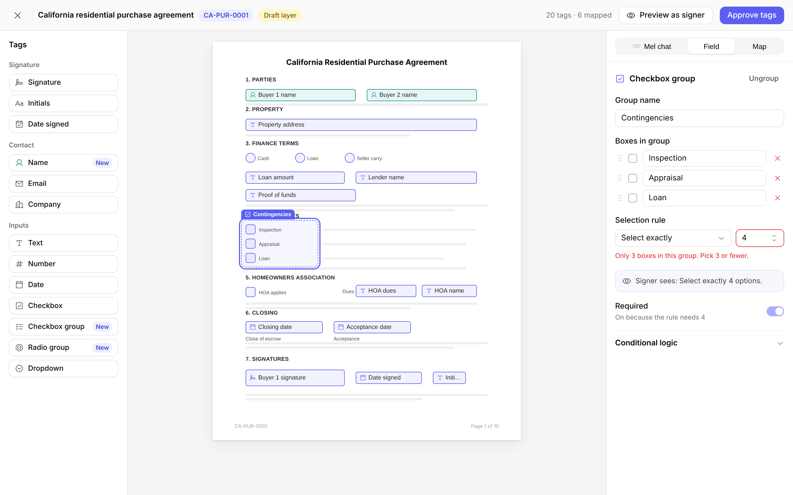

Source: `design/B2-C4-Checkbox-Rule-Error.dc.html` · 1440×900

> Edge: 'Select exactly 4' on a group of 3.  
> What: number field red with inline error. Can't approve tags.  
> Rule: removing a box from a group re-checks the rule.

#### 13 · Select · drag a box

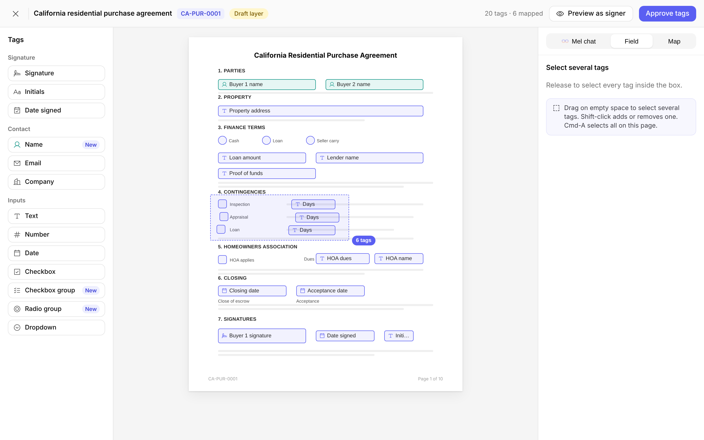

Source: `design/B2-S1-Marquee.dc.html` · 1440×900

> Use case: tidy up misaligned days fields.  
> What: drag on empty page space → dashed box with a live count.  
> Rule: tags partly inside get picked. Shift-click adds or removes one. Selection stays on one page.

#### 14 · Select · align bar

Source: `design/B2-S2-Selected-Align.dc.html` · 1440×900

> What: a floating bar above the selection: align left / centre / right / top / middle / bottom, space evenly, match size, duplicate, delete. The panel shows bulk edit: signer, required (Mixed), formatting.  
> Rule: align uses the selection's outer edge, not the first tag.

#### 15 · Select · done + undo

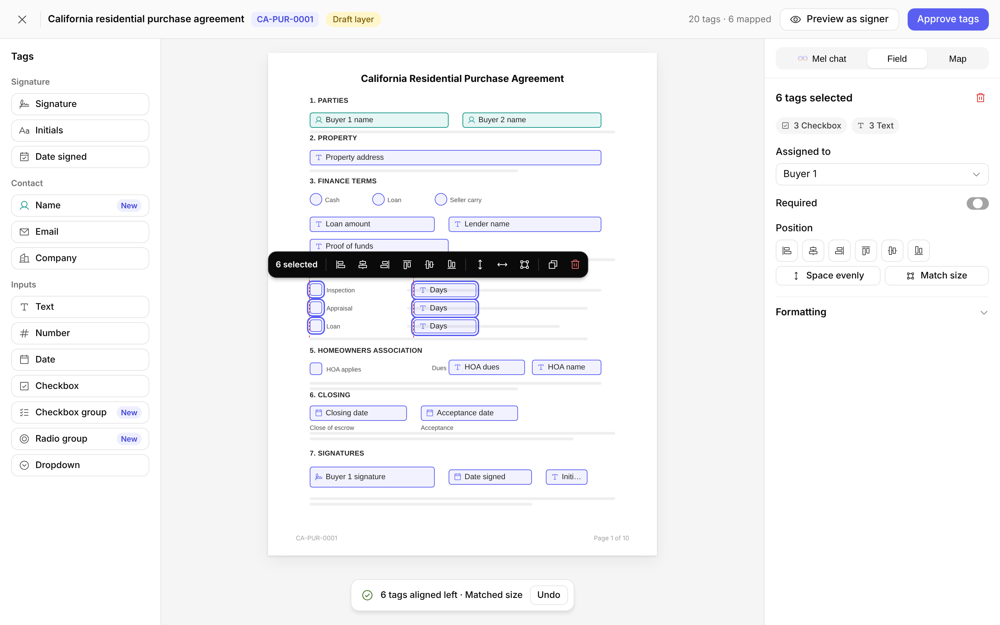

Source: `design/B2-S3-Aligned.dc.html` · 1440×900

> What: tags snap into columns with red guide lines for a moment, plus a toast with Undo.  
> Rule: Cmd-Z also undoes. Nothing is saved until Approve tags.

#### 16 · Select · mixed types

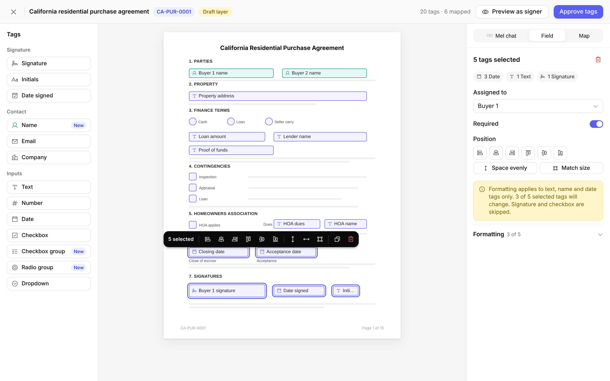

Source: `design/B2-S4-Mixed-Types.dc.html` · 1440×900

> Edge: dates, text and signature selected together.  
> What: type chips at top. Formatting shows '3 of 5' with a note that signature and checkbox are skipped.  
> Rule: bulk edit only shows settings that apply to at least one selected tag.

#### 17 · Data label · link dates

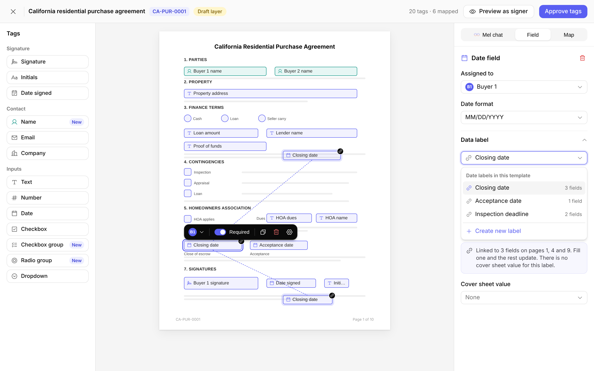

Source: `design/B2-D1-Label-Link.dc.html` · 1440×900

> Use case: Closing date appears on pages 1, 4 and 9 with no cover sheet value.  
> What: pick an existing Date label → all 3 link. Link badges on the page and dashed lines to the linked tags.  
> Rule: fill one and the rest update. Cover sheet mapping wins if set.

#### 18 · Data label · type conflict

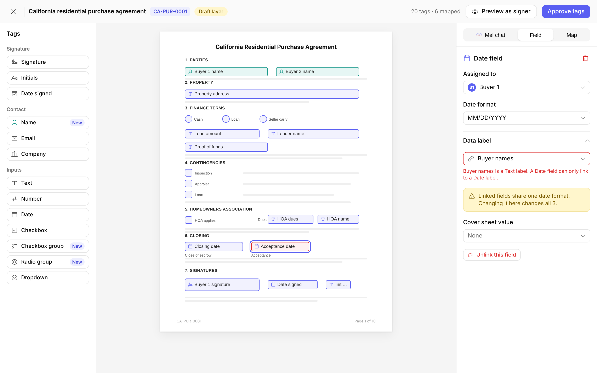

Source: `design/B2-D2-Label-Conflict.dc.html` · 1440×900

> Edges: (a) linking a Date tag to a Text label is blocked with an inline error. (b) Linked dates share one date format, so changing it here changes all.  
> What: 'Unlink this field' gives it back its own value.

#### 19 · Rules · empty

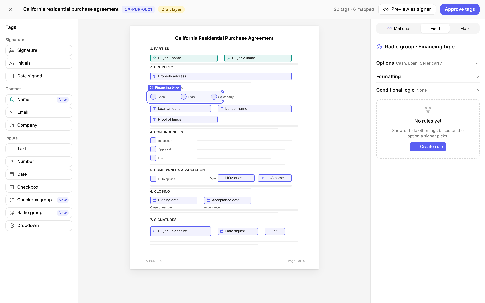

Source: `design/B2-K1-Rule-Empty.dc.html` · 1440×900

> What: the Conditional logic section on a trigger tag (radio group, checkbox, dropdown, text) with an empty state and 'Create rule'.  
> Rule: signature and initials tags can be shown or hidden, but they can't trigger a rule.

#### 20 · Rules · editor (radio)

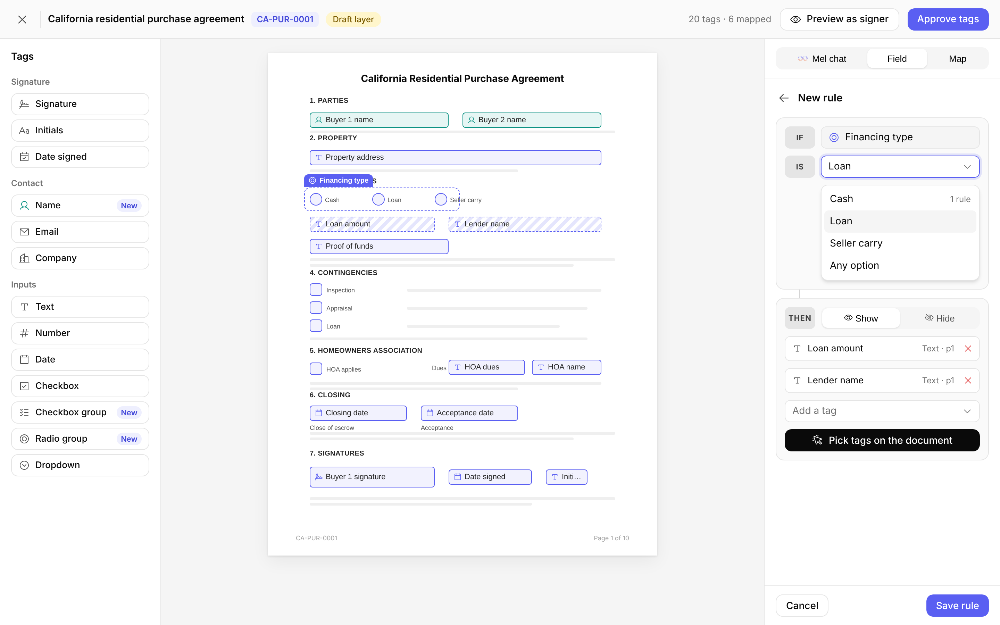

Source: `design/B2-K2-Rule-Editor.dc.html` · 1440×900

> What: IF Financing type IS Loan THEN Show / Hide the listed tags. The IS menu lists real option names (not 'Radio1'), shows which options already have rules, and includes 'Any option'.  
> Tags in the rule are hatched on the page.

#### 21 · Rules · pick on document

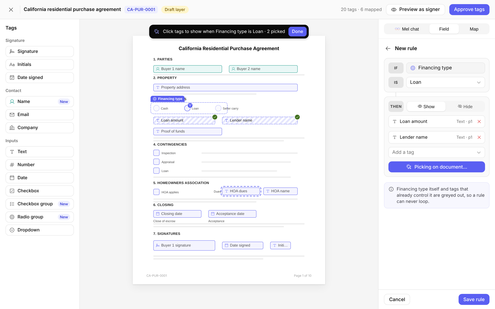

Source: `design/B2-K3-Rule-Pick.dc.html` · 1440×900

> What: banner and a live count. Click tags to add or remove them. Picked tags get a green tick.  
> Rule: the trigger and anything that already controls it are greyed out, so a rule can't loop. Done or Esc returns to the editor.

#### 22 · Rules · overview

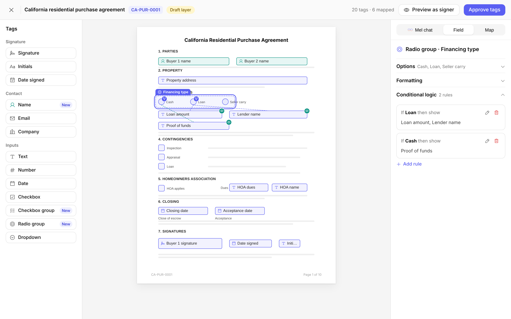

Source: `design/B2-K4-Rule-Overview.dc.html` · 1440×900

> What: selecting a trigger draws dashed lines to every tag it controls. Rules are listed per option with edit and delete.  
> Rule: one rule per option. Each rule can show many tags.

#### 23 · Rules · checkbox trigger

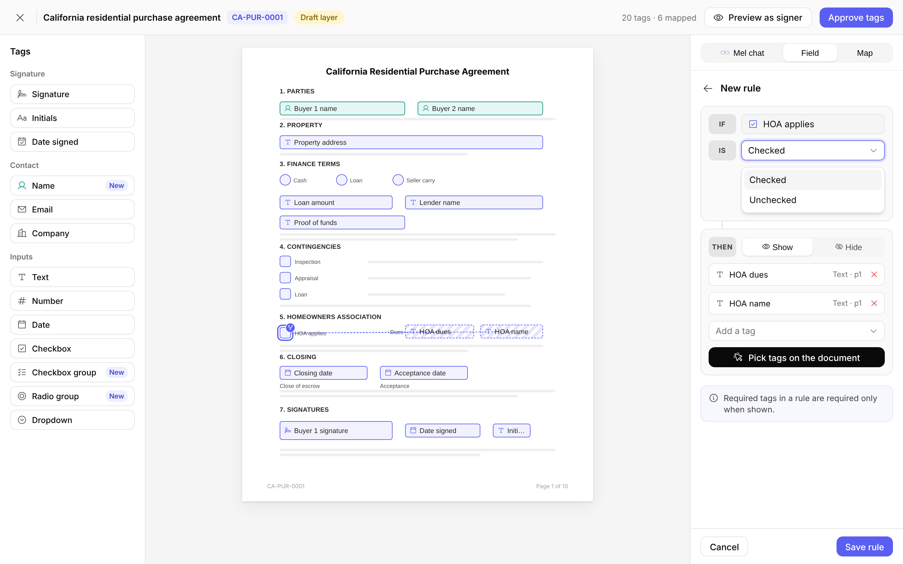

Source: `design/B2-K5-Rule-Checkbox.dc.html` · 1440×900

> Use case: HOA applies → show HOA dues and HOA name.  
> What: IS options are Checked / Unchecked.  
> Rule: a required tag in a rule is required only when shown.

#### 24 · Rules · tag in 2 rules

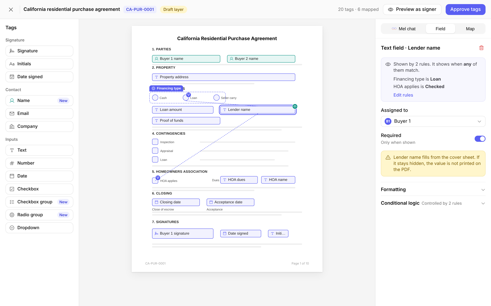

Source: `design/B2-K6-Rule-Dependent.dc.html` · 1440×900

> Edge: Lender name is shown by Financing = Loan and by HOA = Checked.  
> What: the panel lists both rules: it shows if any match.  
> Edge: a hidden mapped tag is not printed on the PDF.

#### 25 · Rules · delete trigger

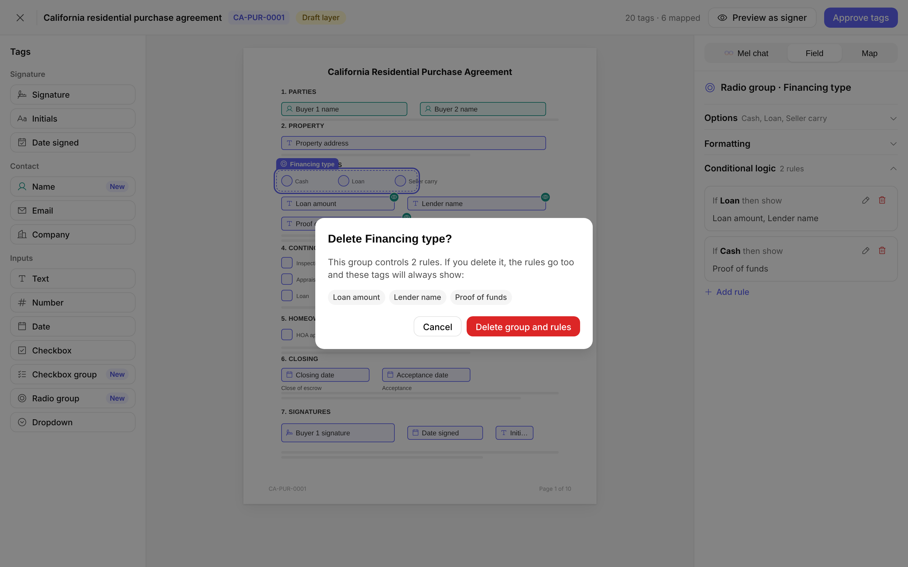

Source: `design/B2-K7-Rule-Delete-Trigger.dc.html` · 1440×900

> Edge: deleting a group that controls rules.  
> What: a confirm dialog lists the tags that will always show after delete.  
> Rule: Undo restores the group and its rules.

#### 26 · Rules · preview as signer

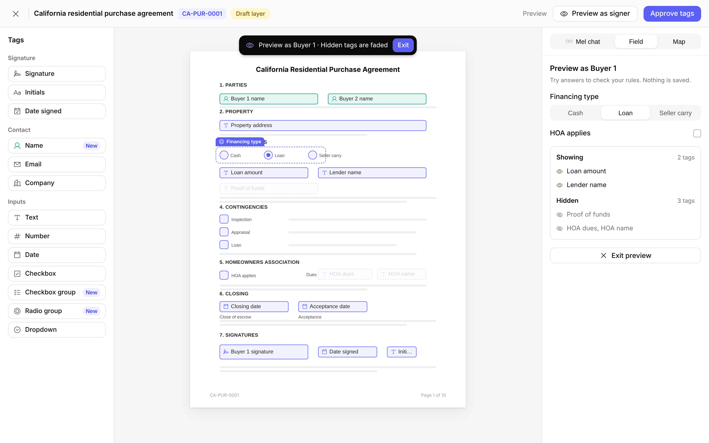

Source: `design/B2-K8-Rule-Preview.dc.html` · 1440×900

> Use case: check rules before approving.  
> What: Preview mode. Try answers in the panel and hidden tags fade on the page. Shows lists of shown and hidden tags.  
> Rule: nothing is saved in preview.
